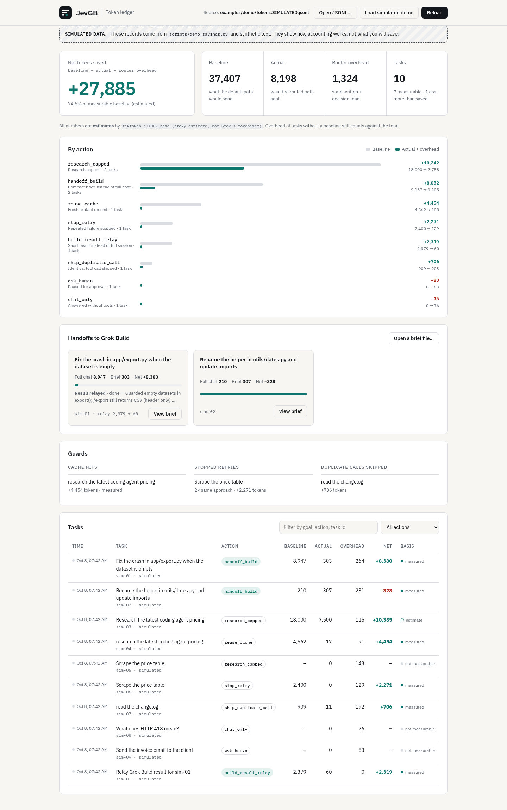

<p align="center"></p>

# JevGB

**Cheap task routing for Grok Bot, compact handoffs to Grok Build, and a token ledger that measures savings instead of promising them.**

The name is short for *Jev* (the TypeSafe classifier upstream uses) + *GB* (Grok Bot), the assistant it works alongside.

> JevGB is an **unofficial community project**. It is not affiliated with or endorsed by xAI. Grok is a trademark of its owner. TypeSafe and Jev are products of TypeSafe.

Extended from [Bodila51/grok-bot-jev](https://github.com/Bodila51/grok-bot-jev) (MIT). The upstream router idea, action set, kill switch and shadow/active modes come from there. See [NOTICE](NOTICE).


<sub>Dashboard screenshot. All data shown is **simulated** (see `scripts/demo_savings.py`).</sub>

## What it does

Before Grok Bot does something expensive, it calls `jevgb route` with a short JSON state. The router picks one action and logs what that decision cost.

| Action | Effect |
| --- | --- |
| `handoff_build` | Code/repo work goes to **Grok Build as a compact brief** (goal, repo, files in scope, constraints, acceptance criteria, do-not-touch list, summarized context), not the full chat. Grok Build reports back with a short `build-result` block. |
| `reuse_cache` | A fresh artifact for the same normalized goal exists (TTL cache): reuse it. |
| `stop_retry` | The same approach failed N times with the same error: stop and change course. |
| `skip_duplicate_call` | Identical tool call within the TTL: point to the earlier result. |
| `research_capped` | Research and browser work capped at N sources × M tokens each. |
| `ask_human` | Send/publish/pay/delete/share/permission actions always pause for approval. |
| `chat_only`, `run_deterministic`, `allow_subagent`, `proceed_full` | As in upstream. |

### Works offline, for free

The default classifier is a **deterministic rule set** (English and Dutch keywords). It needs no network and no account. If `TYPESAFE_API_KEY` is set and `typesafe-sdk` is installed, `classifier: auto` uses TypeSafe Jev instead and falls back to the rules on any error.

> **Note on cost:** TypeSafe Jev is a paid API (listed at $0.042 per million input tokens on [docs.typesafe.ai/models](https://docs.typesafe.ai/models), accessed 2026-10-08). Per a [third-party report updated 2026-10-06](https://jevainews.com/news/typesafe-signups-paused/), new accounts start with $0.00 credit; calls need added funds (card) or a redeem code. Signing up itself did not ask for a card in that report. If you can't or won't add a card, use `classifier: local`. Everything in this repo works with it.

## Install

```bash
git clone https://github.com/SuperfastSimon/jevgb.git && cd jevgb
python3 -m venv .venv
.venv/bin/pip install -e ".[tokens]"     # tiktoken for better estimates; omit for chars/4
cp config.example.yaml config.yaml        # optional; defaults are sensible
```

Command: `jevgb` (short alias: `jgb`). Without installing: `python -m jevgb ...`.

## Use

```bash
# route a task (one compact JSON line out)
jevgb route '{"goal":"Fix the crash in app/export.py on empty data","repo":".","files":["app/export.py"],"history_path":"chat.txt"}'
# -> action handoff_build, handoff.path = handoffs/<task_id>.md, handoff.send_with = grok -p "$(cat ...)"

# hand the brief to Grok Build (headless mode), then relay its result
grok -p "$(cat handoffs/<task_id>.md)" > build_out.txt
jevgb result build_out.txt --task-id <task_id>     # validates build-result, prints a short relay

# make reuse possible
jevgb cache put --goal "Research coding agent pricing" --file brief.md --cost-tokens 9000
jevgb dedupe store --tool web_fetch --args '{"url":"https://example.com"}' --file page.html

# see what it saved (or cost)
jevgb report
jevgb dashboard            # local UI on http://127.0.0.1:8765 (no CDN, no telemetry)
```

- **Grok Bot side:** paste [`skill/jevgb-router.SKILL.md`](skill/jevgb-router.SKILL.md) into a Grok Bot skill.
- **Grok Build side:** copy [`grok-build/AGENTS.md`](grok-build/AGENTS.md) into the target repo.
- Contract details: [`docs/HANDOFF_GROK_BUILD.md`](docs/HANDOFF_GROK_BUILD.md).

Start in `mode: shadow` (advice is logged only). Switch to `active` after reviewing `jevgb report`.

## How savings are measured

```
net saved = baseline − actual − router overhead
```

- **baseline**: what the default path would send (full chat forwarded, cached work redone, duplicate result re-read, one more failed attempt).
- **actual**: what the routed path sent (brief, cached artifact, short relay).
- **overhead**: tokens Grok Bot spends on the router call itself (state written + decision read). It is charged on **every** routed task, including the ones with nothing to save.

Every ledger record (`logs/tokens.jsonl`) carries `estimator` and `baseline_basis`. The report splits net savings by basis quality: **measured** (counted from real text), **estimate** (formula, e.g. planned sources × cap), **caller** (an unverified number you passed in). Nothing is hardcoded.

Guards that make savings likely (not guaranteed): context budget caps, artifact cache with TTL keyed on the normalized goal, duplicate tool-call detection, retry stop after N same-approach failures, extractive summary before every handoff, compact router output by default.

### Demo report (SIMULATED)

`python scripts/demo_savings.py` routes 10 tasks built from **synthetic text** (a fake 120-turn chat, fake web pages, a fake Grok Build session). The counts are real counts of that fake text. They show how the accounting works, **not** what you will save.

```
*** SIMULATED DATA: 10 of 10 records are simulated examples, not real usage. ***
action                 tasks   baseline    actual  overhead       net
ask_human                  1          0         0        83       -83
build_result_relay         1      2,379        60         0     2,319
chat_only                  1          0         0        76       -76
handoff_build              2      9,157       610       493     8,054
research_capped            2     18,000     7,500       258    10,242
reuse_cache                1      4,562        17        91     4,454
skip_duplicate_call        1        909        11       192       706
stop_retry                 1      2,400         0       129     2,271
```

Note the negatives. A handoff after a 2-turn chat cost more than forwarding the chat would have (in the per-task table). The largest line, `research_capped`, rests on an *estimate* basis.

## Tests

```bash
.venv/bin/pip install -e ".[dev]" && .venv/bin/python -m pytest -q
```

Covers the offline classifier, brief generation and budget caps, the return contract, token accounting and reporting, the cache TTL, retry stop, dedupe, the kill switch and the approval gate. No network.

## Limits

- **No guaranteed savings.** Short chats, one-off tasks and tasks with nothing to reuse cost a little overhead and save nothing. The report shows this.
- **Estimates only.** Grok's tokenizer isn't used. tiktoken `cl100k_base` is a proxy; chars/4 is rougher. Grok Bot's real usage meter can differ.
- **Partial view.** Grok Build's own exploration and Grok Bot's wake-up cost are not measured or reduced.
- **Not an interceptor.** Grok Bot must load the skill and call the router. Shadow mode enforces nothing. Active mode works only as far as the skill is followed.
- **Rules classifier is crude.** Keyword rules misclassify. Irreversible verbs win on purpose (false "ask_human" beats a silent send). Jev is better at nuance but is a paid network call.
- **Extractive summary can drop context.** Grok Build is told to report `blocked` instead of guessing.
- **Grok Build access** requires an xAI plan or API key (see their docs). JevGB only writes the brief and a suggested `grok -p` command.
- **Not affiliated with xAI or TypeSafe.** Product behavior and pricing can change at any time.

## Repository layout

```
jevgb/            router, local classifier, handoff + return contract, tokens, ledger, guards, cache, CLI
jevgb/dashboard_static/   dashboard (static HTML/CSS/JS, served by `jevgb dashboard`)
skill/                 Grok Bot skill
grok-build/AGENTS.md   Grok Build receiver instructions
docs/                  handoff contract, architecture, brand, business (EN/NL), Dutch summary
site/                  one-page landing site (static, no external requests)
brand/                 logo SVGs (color, on-dark, mono, favicon)
examples/demo/         SIMULATED demo ledger, briefs and report
media/                 PNG screenshots
tests/                 pytest suite
```

Upstream's `jevopus/` worker sub-project is not included (it is independent of the router; get it from upstream). Upstream's `examples/ab_results.md` (proxy metrics from one recorded upstream run) is kept as-is for history. It is not a JevGB measurement.

## Project docs

[Architecture](docs/architecture.md) · [Handoff contract](docs/HANDOFF_GROK_BUILD.md) · [Brand](docs/brand.md) · [Business rationale](docs/BUSINESS.md) · [Nederlandse samenvatting](docs/SAMENVATTING_NL.md)

## License

MIT, same as upstream. See [LICENSE](LICENSE) and [NOTICE](NOTICE). The logo wordmark is outlined from IBM Plex Sans (SIL Open Font License 1.1).
