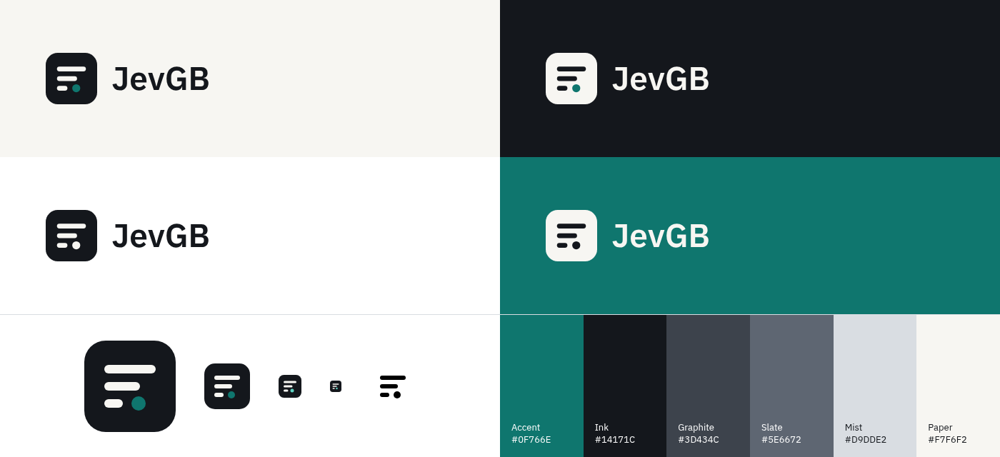

# JevGB brand sheet

## Name

**JevGB**, written as one word: capital J, lowercase *ev*, capital *GB* (never "JevGb" or "JEVGB"). *GB* stands for Grok Bot; spell that out only where context needs it. CLI: `jevgb` (short alias `jgb`). Python package: `jevgb`.

Always pair the name with the disclaimer where people first meet it (README, landing page footer, dashboard footer): *unofficial community project, not affiliated with or endorsed by xAI; Grok is a trademark of its owner.* Don't use xAI or Grok logos, colors or typography. Don't write "official", "by xAI" or "Grok's".

**Fallback names** (no reference to Grok at all): **Handbrief** and **Keelbrief**. The mark is name-independent, so a rename only swaps the wordmark (`scripts/make_brand.py`, one string).

## Mark

A rounded tile with three lines that get shorter (a long context condensed into a brief), ending in a dot (the handoff point). It was drawn on a 64-unit grid: tile radius 15, bars 6 high with radius 3, at y = 17/29/41 and lengths 36/25/13, dot r = 5 at (38, 44).

| file | use |
| --- | --- |
| `brand/logo-color.svg` | default: ink tile, paper bars, teal dot, ink wordmark (light backgrounds) |
| `brand/logo-on-dark.svg` | dark backgrounds: paper tile, ink bars, teal dot, paper wordmark |
| `brand/logo-mono-black.svg` / `logo-mono-white.svg` | single color: print, embossing, one-color contexts |
| `brand/mark-color.svg` | mark alone (app icon, avatar) |
| `brand/mark-mono.svg` | mark without tile, `currentColor`, for inline UI |
| `brand/favicon.svg` | favicon; the dot uses the lighter teal for small sizes |
| `media/mark-512.png`, `media/logo.png` | raster exports |

Clear space: at least the dot's diameter (10/64 of the mark) on all sides. Minimum size: 16 px for the mark, 96 px wide for the full logo. Don't stretch, recolor the bars, add effects, gradients or outlines, or put the color logo on busy photos.

## Color

One accent plus neutrals.

| role | name | hex | notes |
| --- | --- | --- | --- |
| accent | Teal | `#0F766E` | 5.4:1 on white. Use for links, focus rings, positive numbers, the dot. |
| accent (dark UI) | Teal light | `#5FD3C3` | Same hue, for dark backgrounds only. |
| text | Ink | `#14171C` | primary text, tile |
| text 2 | Graphite | `#3D434C` | secondary text |
| muted | Slate | `#5E6672` | captions, labels (AA on paper and white) |
| line | Mist | `#D9DDE2` | borders, baseline bars |
| surface | Haze | `#ECEEF0` | code backgrounds, hover |
| background | Paper | `#F7F6F2` | page background |

Negative numbers use a functional red (`#B42318`, or `#F97066` on dark). It's a status color, not a brand color.

## Type

- **IBM Plex Sans** (SemiBold 600 for headings and the wordmark, Regular 400 for body). Falls back to the system UI stack. No web fonts are loaded, so it renders from local fonts only.
- **IBM Plex Mono** for code, action names, numbers in labels. Falls back to `ui-monospace`.
- Tabular numbers (`font-feature-settings: "tnum"`) in tables and KPIs.
- Headings use tight tracking (−0.02 to −0.035em). Uppercase labels use +0.07em tracking at 12–13 px.

## Voice

Calm, specific, honest. Say "estimated" when it's an estimate. Show negative results. Avoid "save X%" claims, superlatives and urgency.
